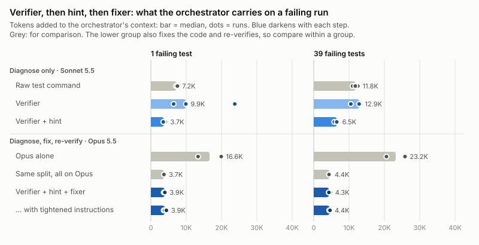
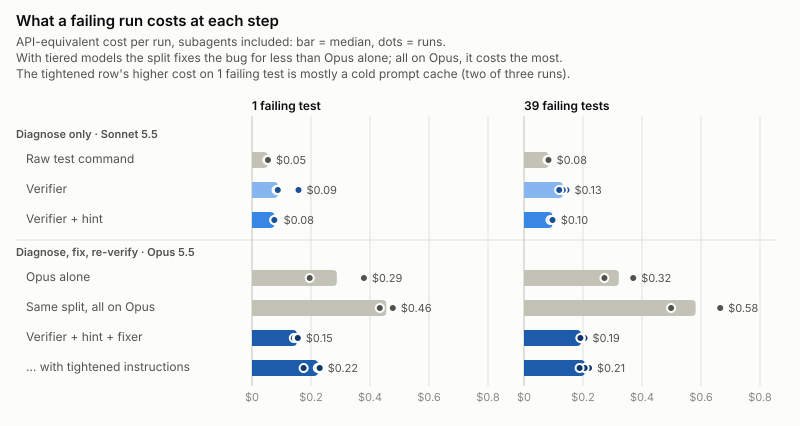
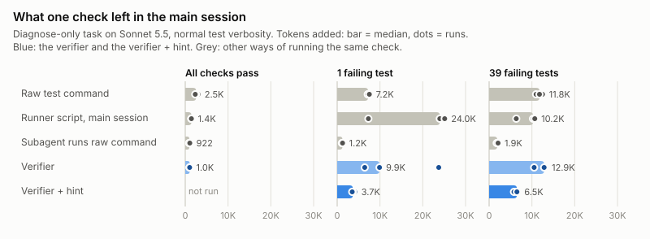
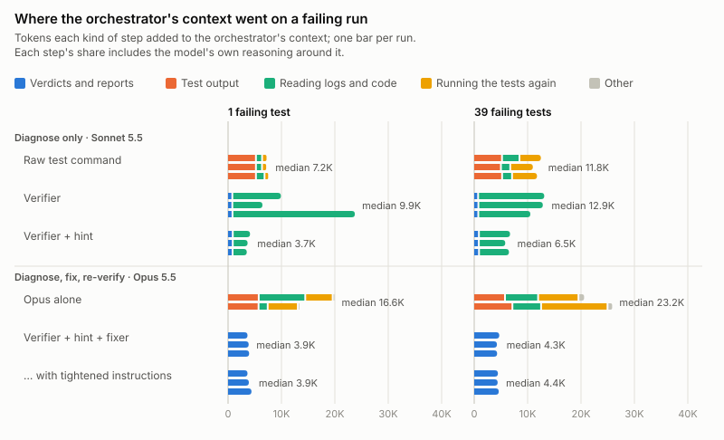
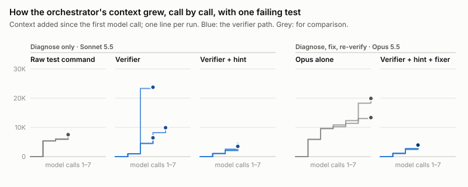

# Verifier subagent experiment: results

What does a coding agent's "did my change work?" step put into its main session, and what does it cost? This experiment ran that step, the build and the tests, on this repository in nine ways. They range from running the tests directly in the main session to a split workflow, in which a verifier subagent and a separate diagnose-and-fix subagent run on different models. A third part then asked the question that matters most in everyday use, inside a long-running session: when a check fails, should the orchestrator fix it itself, or hand it to a separate fixer?

**72 measured sessions** on 21 October 2026, plus **12 long-session runs** (24 turns) on 23 and 24 October · this repository at `a4f219e` · Claude Code 2.1.306 · Lattice 2.1.0 · Sonnet 5.5, Opus 5.5 and Haiku 5.5 · all 72 answers correct · every fix (22 sessions, 24 long-session turns) re-checked independently by the harness

Every number here is generated from the per-run data: by `harness/report.py` for Parts 1 and 2 ([results/tables.md](results/tables.md), [results/runs.csv](results/runs.csv)), and by `harness/analyze_long.py` for Part 3 ([results/long-session.md](results/long-session.md)). The predictions were written down before the runs they describe ([PROTOCOL.md](PROTOCOL.md)).

## The answer

- **A verifier on its own protects the orchestrator only when the verdict is all it needs.** On passing runs it cut what one check left in the main session by 60%, and by 80% at the repository's default test verbosity. On failing runs it did not help: the main session opened the failing log itself, and the saving was lost.
- **A one-line failure hint makes the verifier pay off on failing runs.** Telling the caller how to search the failing log cut the verifier's footprint by 63% with 1 failing test, and by 49% with 39.
- **A separate diagnose-and-fix agent takes the failure out of the orchestrator.** With Opus orchestrating, a Haiku verifier and a Sonnet fixer working from the verifier's logs, the orchestrator carried about 4K tokens whatever failed. The suite ran exactly twice. Opus doing the same job alone carried 16.6K to 23.2K tokens and ran the suite 3 to 7 times.
- **In a long session, hand the failure over by default, brief the fixer, and check its diff** (Part 3). In a 105K-token session that already held the code:
  - For a 39-test failure the orchestrator hadn't caused, a fixer left 5K tokens in the orchestrator, against 12K when the orchestrator fixed it itself. The turn cost 10–16% less, and about a third less once 100 later calls re-read what it left.
  - The orchestrator passed the user's intent on to the fixer even when its rules didn't ask for a brief (3 of 3 runs), so delegating did not lose it. The fixer's description invites a brief, so this arm was nudged, and a fixer with no intent at all was never tested.
  - The fixer's weakness was precision. It widened the fix in 3 of 6 runs, while the orchestrator fixing it itself reverted exactly every time. The orchestrator flagged each widened fix to the user as a decision, but none sent one back.
  - For a 1-test failure from the user's own change, fixing it in the orchestrator cost about the same, as long as nothing unexpected came up.
  - Letting the fixer confirm its own fix (Part 3b, 3 runs) worked as well, but no better at this size. Every task ended green and the orchestrator carried a little less (4.2K against 5.1K on the 39-test failure), but its calls, cost and time didn't change: every first fix worked, and the orchestrator spent the call it saved on checking the change itself. The fixer still widened the fix in 2 of 3.
- **Three levers, each buying something different:**
  - **The split buys context.** With every role on Opus it kept the same ~4K, and in a long session it saved money as well.
  - **The models buy money.** Tiered, the split cost 40–47% less than Opus alone. All on Opus, it cost 1.6 to 1.8 times as much.
  - **The instructions buy trust.** About four more sentences per agent removed the verifier's format slips and the fixer's unrequested change, for one to two cents a run.

## Terms

| Term | Meaning here |
|---|---|
| Orchestrator | the main session, the agent the user talks to. In Part 1 it diagnoses; in Part 2 it coordinates the fix; in Part 3 it is a long-running session that already holds the code |
| Self-fix, fixer with brief, fixer without brief, fixer confirms its own fix | Part 3's arms (V, FB, F0) and Part 3b's (FV): in a long session, who diagnoses and fixes a failure, and in FV who confirms the fix. "Without brief" means the arm's rules don't ask for one; the fixer's description, which every arm sees, still invites one |
| Footprint | what a session added to the orchestrator's context: the context of its last model call minus its first (input + cache writes + cache reads) |
| Verifier | Lattice's `lattice:verifier` subagent. It runs the configured stages through a script that writes one log per stage and a `summary.json`, and returns that summary verbatim |
| Hint | one `failureHint` line in `verification.yaml`, copied into `summary.json`: how to grep a failing log for the test names and first errors |
| Fixer | a diagnose-and-fix subagent with Read, Grep, Glob and Edit, and no shell. It works from the verifier's summary and logs, and cannot re-run tests |
| Cost | Claude Code's own `total_cost_usd` for the session: an API-equivalent estimate that includes subagents |
| G, R1, R3 | the scenarios: all checks pass; 1 failing test; 39 failing tests |

## The ladder





These are medians over failing runs:
- The top three rows only diagnose, on Sonnet 5.5.
- The bottom four also fix the code and re-verify it, with Opus 5.5 as the orchestrator.

So compare rows within a group, not across groups.

| Step (arm) | Who does what | Orchestrator context, R1 / R3 | Cost per run, R1 / R3 |
|---|---|---|---|
| Raw test command (A) | the main session runs the tests and reads everything | 7.2K / 11.8K | $0.05 / $0.08 |
| Verifier (D) | a verifier subagent returns the verdict; the main session then reads the failing log | 9.9K / 12.9K | $0.09 / $0.13 |
| Verifier + hint (H) | the same, plus one config line on how to search the log | 3.7K / 6.5K | $0.08 / $0.10 |
| Opus alone (S) | one Opus session runs, diagnoses, fixes and re-runs everything | 16.6K / 23.2K | $0.29 / $0.32 |
| Same split, all on Opus (O) | the same flow and prompts as T, with Opus in every role | 3.7K / 4.4K | $0.46 / $0.58 |
| **Verifier + hint + fixer (T)** | Opus orchestrates; Haiku verifies; on red, Sonnet diagnoses and fixes from the logs; Haiku re-verifies | **3.9K / 4.3K** | **$0.15 / $0.19** |
| … with tightened instructions (T2) | as T, with a strict output rule for the verifier and "fix only what the failing tests need; return a diff" for the fixer | 3.9K / 4.4K | $0.22 / $0.21 |

T2's R1 cost is inflated: two of its three R1 runs started with a cold prompt cache, and the run with a warm cache cost $0.18.

## Six contrasts

### 1. The verifier against running the tests directly



- **Passing runs: the verifier wins.**
  - At normal verbosity, the main session's footprint fell from 2.5K to 1.0K tokens (−60%).
  - At the repository's default verbosity it fell from 5.2K to 1.1K (−80%). There, Claude Code had saved the raw output to a file, and the main session read into it.
- **Failing runs: it did not help.**
  - The footprint rose from 7.2K to 9.9K on R1 (+37%) and from 11.8K to 12.9K on R3 (+9%). On R1 it varied between runs from 6.4K to 23.7K.
  - The verdict itself was small, 1.7K to 1.9K characters. The cost came after it, when the main session opened the failing log. It tried to read the log whole in 3 of 6 runs. Claude Code refused 2 of those reads, because the log was over its 256 KB read limit, so the session searched the log and read slices of it instead.
  - At default verbosity the failing log is a third of the size, and there the verifier did leave less on R1: 4.0K against 7.0K (n = 2).
- **With Sonnet everywhere, the verifier never saved money.** It cost $0.05 to $0.13 per check, against $0.03 to $0.08 for the raw command. Each verifier call costs its subagent 40K to 54K processed tokens, mostly cache reads, just to start and run one command.

### 2. Adding the hint

The whole change is one line in `verification.yaml` ([inputs/config/failure-hint.patch](inputs/config/failure-hint.patch)):

```yaml
failureHint: Search a failed stage's log rather than reading it whole. grep -c '^ *Failed ' <logFile> counts the failing tests, grep '^ *Failed ' <logFile> names them, and grep -m 5 -A4 'Error Message:' <logFile> shows the first error messages.
```

- **The verifier's failing-run footprint fell 63% on R1 (9.9K to 3.7K) and 49% on R3 (12.9K to 6.5K).** That is about half of the raw command's footprint.
- **Every hinted run began with the hinted searches and made one follow-up grep. None read a log whole (6 of 6).**
- **Cost fell 13% on R1 and 27% on R3** ($0.087 to $0.076; $0.131 to $0.097, 26.5% before rounding).

In this data, the hint did more for the failing path than the subagent did.

### 3. Adding the fixer: the split against Opus alone

- **Context.** The split's orchestrator carried 3.9K tokens against 16.6K on R1, and 4.3K against 23.2K on R3: 77% and 82% less. It stopped paying for the size of the failure. Going from 1 failing test to 39 added 0.4K to the split's orchestrator, and 6.6K to Opus alone.
- **No repeated work.** The split ran the suite exactly twice in every failing run: verify, then confirm. Opus alone ran it 3 to 7 times.
- **Cost.** The split cost $0.15 against $0.29 on R1, and $0.19 against $0.32 on R3: 47% and 40% less.
- **Time.** The split was 10 to 17 seconds slower (71 s against 54 to 61 s), the price of three hand-offs.
- **Outcome.** Every fix in both arms held under the harness's own re-check.

Part 1 had already pointed this way. A general-purpose subagent that both ran and diagnosed the tests (arm C) kept the main session at 0.9K to 1.9K. But on Sonnet it was among the most expensive ways to check, at $0.10 to $0.14.

### 4. The split, or the models?

Arm O ran the same flow and prompts as T, with Opus in every role.
- **Context and suite runs did not change.** The orchestrator carried 3.7K and 4.4K tokens, and the suite ran exactly twice in every run. **The split delivers the context.**
- **Cost rose to $0.46 and $0.58**, 1.6 to 1.8 times as much as Opus alone. Every subagent starts its own context, and here all of it was billed at Opus prices: the verifier processed about 108K tokens per failing run, and the fixer 97K to 133K. Tiered, the same flow cost a third as much. **The models deliver the money.**

### 5. Loose against tightened instructions

Under T's original instructions:
- **The Haiku verifier broke its "return the JSON verbatim" contract in 3 of 14 calls.** Two replies fenced the JSON; one added a sentence.
- **The Sonnet fixer went beyond the failure on R3.** It was asked for "the smallest change that restores the intended behaviour". It reverted R1 exactly. On R3 it also made the built-in matcher names case-insensitive, in 3 of 3 runs. It reported the extra change, and the orchestrator passed it on; in 1 of the 3 runs it suggested reverting that line. Under the same instruction, the Opus fixer reverted R3 exactly (2 of 2).

T2 added about four sentences to each agent's instructions ([inputs/config/agents-tiered-v2.json](inputs/config/agents-tiered-v2.json)). The verifier got a strict output rule: the reply is the JSON and nothing else. The fixer was told to fix only what the failing tests need, to prefer undoing the faulty change over working around it, and to include a unified diff in its reply. With that:
- **The verifier returned its JSON verbatim in 12 of 12 calls.**
- **The fixer made no unrequested change, and showed its diff in 6 of 6 runs.** Five fixes were byte-exact reverts; the sixth dropped a space after a comma.
- **Context and suite runs were unchanged.** The cost was one to two cents a run more: on R3, $0.206 against $0.193.

### 6. In a long session: fix it yourself, or hand it over?

Part 3 forked one 105K-token session, which had already read the matching code and its tests, nine times. Every fork ran the verifier with the hint, and they differed only in who diagnosed and fixed a failure. Each played two turns:
1. A 39-test failure from "my teammates' changes", which the session knew nothing about.
2. A 1-test failure from the user's own, intended wording change.

| Turn 1: 39 failing tests the orchestrator didn't cause | Self-fix | Fixer, with or without a brief |
|---|---|---|
| Left in the orchestrator | 12.4K | 5.0K to 5.1K (59% less) |
| Turn cost | $0.34 | $0.29 to $0.30 (10% to 16% less) |
| Turn cost plus 100 later calls re-reading what it left | $0.59 | $0.39 to $0.41 (31% to 33% less) |
| Exact revert of the teammates' change | 3 of 3 | 3 of 6; the fixer widened the fix in the other 3 |
| Time | 76 s | 93 s to 107 s |

- **The intent survived delegation.**
  - On turn 2 every run kept the new wording and updated the test, 9 of 9.
  - With rules that only said to hand over the verdict, the orchestrator still wrote the intent into its brief ("an INTENDED behaviour change… do NOT revert") in 3 of 3 runs. The fixer's description, which every arm sees, says to give it the summary "and, if you have one, a brief", so this arm was nudged rather than unprompted.
  - In a long session the orchestrator holds the intent, and one line in the fixer's definition was enough for it to pass the intent on.
- **On a small failure from its own change, fixing it itself cost about the same,** as long as nothing else went wrong: $0.21 in the one clean self-fix run, against $0.24 to $0.29 for the fixer.
- **Noise lands where the reading happens.** The flaky port race and a transient build failure hit 3 of the 18 turns.
  - The self-fixing orchestrator investigated them in its own context, adding 4K to 9K tokens.
  - The fixer absorbed one in its own context, with about 3K more in the orchestrator.
- **What a turn leaves is carried.** After turn 1, the self-fix sessions went into turn 2 about 7K tokens heavier than the others, and every later call re-reads them.
- **The fixer's risk is precision.** On turn 1 the Sonnet fixer made the matcher names case-insensitive in 3 of 6 runs. It had done so in Part 2 under the loose instruction, and here it did so despite the "fix only what the failing tests need" rule that stopped it in Part 2b.
  - Every orchestrator flagged the extra change to the user as a decision, and two offered to take it out, one after reading the file itself (L-FB-r3, L-F0-r2). None sent it back on its own, and in a headless run nobody answered.
  - One orchestrator had not looked at the edited file, because its rules said to leave the fix to the fixer (L-FB-r1). A check of the diff needs a rule of its own.

**Part 3b: what if the fixer confirms its own fix?** Three more forks took the route orchestrator → verifier → orchestrator → fixer → verifier. The fixer spawned the verifier itself, and the orchestrator didn't run it again.

| Turn 1: 39 failing tests | Fixer with brief (FB) | Fixer confirms its own fix (FV) |
|---|---|---|
| Left in the orchestrator | 5.1K | 4.2K |
| Orchestrator calls | 4 | 4 |
| Turn cost; with 100 later calls | $0.30; $0.41 | $0.32; $0.40 |
| Time | 93 s | 90 s |
| Exact revert | 1 of 3 | 1 of 3 |

- **The route worked.** Every FV turn ended green. The orchestrator ran the verifier exactly once per turn, and the fixer ran it once.
- **The saved call went to a check.** In 6 of 6 turns the orchestrator checked the fixer's change itself, with one targeted search or, once, by reading the file, before it reported.
- **The widening was flagged, not fixed.** In both widened runs the orchestrator flagged the extra change as a decision for the user, and one offered to revert it. Neither sent it back.
- **Turn 2 matched too:** 4.1K against 4.6K in the orchestrator, $0.27 against $0.24, all correct.
- **The two routes came out close.** At this size, with every first fix working, the case FV was built for never came up: extra fix rounds staying inside the fixer.

## Why: where the orchestrator's context went



The figure splits each failing run's footprint by the kind of step that added it. The method is under [How it was run](#how-it-was-run); the table view is section 8 of [results/tables.md](results/tables.md).
- **The raw command and Opus alone** pay for the test output itself, for reading logs and code, and for running the tests again. Claude Code cut the raw command's failing output, so that arm re-ran the suite to see the failure. Opus alone trimmed its first run with `tail`, re-ran it to find the failing tests, and ran the suite again after its edit.
- **The verifier** pays almost entirely for reading logs, after a cheap verdict.
- **The verifier with the hint** reads the same logs with a few targeted greps.
- **The verifier, hint and fixer** carry nothing but verdicts and reports. The logs and the source were read in the fixer's context, at Sonnet's price.



Over time, the picture is the same:
- the verifier's footprint jumps when the main session reads the log;
- Opus alone climbs with each re-run;
- the split climbs in three small steps, one per hand-off.

## Other things we learned

- **Claude Code hides the end of failing output.** Probes P1 and P2 printed 127 KB of numbered lines.
  - From a command that exits 0, Claude Code 2.1.306 saved the output to a file and showed the model a 2 KB preview and the path.
  - From a command that exits non-zero, the model saw about 10K characters taken from the first 30K, with a `[20012 characters truncated]` marker in the middle. The rest was dropped, with no marker and no file.

  So on a failing build, the summary line at the end never reaches the model. That is why the raw-command arm re-ran the suite in every failing run at normal verbosity (6 of 6). In the 2 default-verbosity runs the failure was still visible in the cut output, and the second run was the component stage that the failing chain had skipped.
- **Most of the output is noise.** A passing run prints 33 KB at the repository's default verbosity and 144 KB at `normal`; the verifier's verdict is about 1 KB. 23 KB of every run is NuGet vulnerability warnings. They appeared with no change to the code, because they depend on advisory data at restore time.
- **The verifier did its job; the cost came after it.** The verifier returned `summary.json` verbatim in 18 of 19 Part 1 runs and never opened a log. The main session had to say why tests failed, and was allowed to open a failed stage's log. It did so in every failing verifier run, 12 of 12.
- **Delegation costs oversight.** A delegated fixer makes decisions the orchestrator only hears about afterwards (contrast 5). A diff in the fixer's reply makes the change checkable.
- **This repository has a flaky port race.** `TestPort.GetFree()` releases a port before a test binds it. The readiness-probe tests that use it failed in 2 of 40 unit runs during calibration, and in 3 of the 22 fix-workflow runs. No agent tried to fix them; each reported the failure as unrelated.

## What this means

**Three levers, each paying for something different:**
1. **Splitting verification from diagnosis and fixing pays for context.** Even with Opus in every role, the orchestrator stayed near 4K tokens and nothing was re-run. In a long session it pays in money too: what the orchestrator doesn't read, it doesn't carry into every later call.
2. **Matching each job to a model pays for money.** The split alone cost more than one Opus session; tiered, it cost less.
3. **Explicit agent instructions pay for trust.** They removed the format slips and the unrequested change, without costing context.

A verdict on its own protects the orchestrator only when the verdict is all it needs, which on green it is. On red, the expensive part is the diagnosis. It needs either a cheap path (a hint) or a separate place to happen (a diagnose-and-fix agent). What remains is oversight.

**In a long session (Part 3):**
- **Delegate the failure by default.**
- **Have the orchestrator brief the fixer on the intent.** Opus did so whenever the fixer's description invited it. A rule makes that independent of the description.
- **Check the returned diff against the brief, and send anything extra back, before accepting it.** In Part 3 the orchestrators flagged the fixer's widened changes to the user but sent none back, and one had not looked at the edited file.
- **Let the orchestrator fix it itself only when the failure is small and its cause is a change the session already knows about** (in Part 3, the user's own wording change; one clean run).
- **Letting the fixer confirm its own fix is an option, not yet an improvement.** In Part 3b it did as well as the orchestrator re-verifying, but no better, because every first fix worked. Its case rests on fixes that take more than one round.

**For the verifier's design (Lattice 2.1.0), in priority order:**
1. **Make `failureHint` a default.** `/lattice-init` should propose one for each runner it detects (dotnet test, pytest, jest, go test). In this data, the hint did more for the failing path than the subagent did.
2. **Fix the gate text.** "Never open or paste a log" contradicts the design documentation, and it cannot hold for a caller that has to diagnose: asked why tests failed, the caller opened the log in every failing verifier run. Replace the prohibition with the cheap way to look.
3. **Consider a capped failure excerpt in `summary.json`.** The runner could extract failing test names and the first error messages deterministically. That keeps the verdict deterministic and makes most log reads unnecessary. (Untested.)
4. **Tighten the verifier's output contract.** The Sonnet verifier added prose after the JSON in 1 of 19 runs; the Haiku verifier fenced or annotated it in 3 of 14 calls. The tightened instruction removed this (12 of 12). As a fallback, parse tolerantly, or have the orchestrator read `summary.json` from disk.
5. **Provide a diagnose-and-fix companion.**
   - **What it is:** an agent with no shell that takes the verifier's summary and a short brief (what changed, and whether a behaviour change was intended), and returns its diff.
   - **The orchestrator's job:** check that the change stays within the failure. In Part 3, the orchestrators flagged the fixer's widened changes but sent none back.
   - **The gate then becomes:** "On red, give the summary and a brief to the fixer, check its diff, then re-verify; never open logs yourself."
   - **Starting points:** `inputs/config/agents-tiered-v2.json` and `inputs/config/agents-long.json` are tested, with the verifier on Haiku and the fixer on Sonnet.

**Open questions:**
- Whether a fixer that confirms its own fix pays off when the first fix fails; in Part 3b every first fix worked.
- How the long-session result holds over many fix cycles, with other orchestrator models, with a fixer that gets no intent at all, and when the orchestrator is told to check the fixer's diff. Part 3 measured two turns, with Opus, and no diff-check rule.
- Whether the results hold for other test runners (pytest `-v`, jest), and for multi-file or ambiguous bugs, where diagnosis quality may depend more on the model.
- Whether a smaller footprint improves the orchestrator's later decisions. This experiment measured what the orchestrator carries, not how well it reasons.
- How the split compares with an Opus-alone baseline that also uses the runner script and the hint. That baseline was not run.

## How it was run

- **Repository and checks.** This repository at `a4f219e` was exported read-only into a disposable workspace, which was reset by content between runs. Verification has three stages: `make build`, `make unit` (265 test attributes, run on net9.0 and net10.0) and `make component` (20 tests).
- **Scenarios.** G: unchanged code. R1: a one-line regression in `DeltaFormatter`, so 1 unit test fails on both target frameworks. R3: a two-line regression in `SemanticMatcher`, so 39 unit tests fail on both ([inputs/scenarios/](inputs/scenarios/)).
- **Verbosity.** Every arm used `normal` test verbosity, one line per test (like `pytest -v`). Arms A and D also ran at the repository's committed `minimal` verbosity, as a control.
- **Host.** Claude Code 2.1.306, as headless `claude -p` sessions at medium effort. Each ran in a sanitized environment with auto-update off, a fixed tool allowlist per arm, and a warm build before the session.
- **Tasks.** Part 1 asked every arm whether the checks pass and, if not, which tests fail and why, without changing anything; the verifier arms were allowed to open a failed stage's log. Part 2 asked for the checks to pass by fixing production code, never the tests. The orchestrator prompt is byte-identical across T, O and T2 ([inputs/prompts/](inputs/prompts/)).
- **Arms:**

  | Arm | Name in the figures | Part | Models | What runs the check |
  |---|---|---|---|---|
  | A | Raw test command | 1 | Sonnet | the main session runs `make build && make unit && make component` |
  | B | Runner script, main session | 1 | Sonnet | the main session runs Lattice's runner script, then reads `summary.json` |
  | C | Subagent runs raw command | 1 | Sonnet | a general-purpose subagent runs the raw command and reports back |
  | D | Verifier | 1 | Sonnet | Lattice's `verifier` subagent |
  | H | Verifier + hint | 1 | Sonnet | D, plus the `failureHint` line |
  | S | Opus alone | 2 | Opus | one session runs the raw command, diagnoses, edits and re-runs, with at most three attempts |
  | T | Verifier + hint + fixer | 2 | Opus orchestrator, Haiku verifier, Sonnet fixer | verifier → on red, fixer → verifier again; hint applied |
  | O | Same split, all on Opus | 2b | Opus in every role | T with every role on Opus |
  | T2 | … with tightened instructions | 2b | as T | T with about four more sentences per agent |
  | V | Self-fix | 3 | Opus orchestrator, Haiku verifier | in a long session, the orchestrator diagnoses with the hint and fixes it itself |
  | FB | Fixer with brief | 3 | Opus orchestrator, Haiku verifier, Sonnet fixer | the orchestrator hands the summary and a brief to the fixer |
  | F0 | Fixer, no brief | 3 | as FB | the orchestrator hands the summary to the fixer, as in Part 2 |
  | FV | Fixer confirms its own fix | 3b | as FB | as FB, but the fixer spawns the verifier itself to confirm its fix, and the orchestrator does not run it again |

- **Part 3, long session.**
  - **Base:** one base session, built once, read the matching code and its tests and explained them. It reached 104.6K tokens of context and changed no files.
  - **Forks:** nine forks of it (`--resume --fork-session`) each played two turns, with an Opus orchestrator, the Haiku verifier and the hint. Turn 1 applied the R3 regression as "my teammates' changes"; turn 2 applied the R1 change as the user's own product decision.
  - **Same prefix:** the arm's rules sat in the turn prompts, so every session had the same system prompt and cached prefix.
  - **Version:** Claude Code was pinned to 2.1.306.
  - **Part 3b:** three more forks, run a day later, of the arm FV (section 5d of PROTOCOL.md).
    - The fixer's definition is in `inputs/config/agents-long-fv.json`.
    - Because that differs from the base session's definitions, the first FV call re-wrote the cached prefix.
- **Runs.** n = 3 per Part 1 cell (2 for the verbosity control), and 2 or 3 per Part 2 cell: 72 measured sessions. Part 3: 3 runs per arm, 18 turns; Part 3b: 3 runs, 6 turns. There were also 9 pilot sessions, 1 Part 3 pilot, 1 Part 3b probe and 2 probes, kept as evidence but not counted.
- **Measures:**
  - **Footprint:** from the transcript's usage fields, one value per model call.
  - **Composition (fig4):** the growth in context between two model calls is attributed to the tool calls the first one issued, split by the size of what they returned. It sums exactly to the footprint.
  - **Suite runs:** every execution of the suite or one of its stages, by anyone.
  - **Cost:** `total_cost_usd`. In Part 3, each turn's increment of the session's cumulative cost. Projections add the footprint re-read by 100 later orchestrator calls at the cache-read price ($0.20 per million tokens).
  - **Wall time:** excludes any run with a single wait over 120 s, an infrastructure stall.
  - **Correctness:** every answer was checked by script and then read by hand ([results/answers.md](results/answers.md)). After each fix session, the harness saved the net code change and re-ran the checks itself.
- **Pre-registration.** There were 30 predictions, each written down before the runs it describes. Every deviation from the plan is logged in [PROTOCOL.md](PROTOCOL.md).

## Details

### Part 1: verification only (Sonnet 5.5, 50 sessions)

**The question:** when does a verifier subagent protect the orchestrator's context, and what does that protection cost?

**How much output there is to keep out.** These are runner-only measurements, with no agent involved ([data/calibration/calibration.md](data/calibration/calibration.md)).

| Scenario | Raw output, default verbosity | Raw output, normal | `summary.json` |
|---|---|---|---|
| G | 33,313 bytes | 144,138 bytes | 1,093 bytes |
| R1 | 29,666 bytes | 97,591 bytes | 957 bytes |
| R3 | 131,532 bytes | 286,437 bytes | 957 bytes |

**What the host does with large output.** Probes P1 and P2 printed the same 127 KB of numbered lines, first from a command that exits 0, then from one that exits 1.

| | Command exits 0 | Command exits non-zero |
|---|---|---|
| What the model sees | 2,248 characters: the first 2 KB, plus the path to a file holding all 127 KB | 10,040 characters: about 5K from the start, then `[20012 characters truncated]`, then about 5K from around position 25K to 30K |
| The rest | saved to disk and readable | dropped, with no marker and no file |
| Effect in the runs | arm A read into the spilled file in every green run (5 of 5) | arm A ran the suite again in every red run (8 of 8). In the 6 normal-verbosity runs it re-ran it into a file in `/tmp` and grepped that file, rebuilding the runner's pattern by hand. In the 2 default-verbosity runs the failure was visible in the cut output, and the second run was the component stage the chain had skipped |

This differs from the commonly described behaviour, a 30,000-character cap that keeps the head and the tail. On failure, the real tail of the output never reaches the model, and the summary line goes with it.

**What one check left in the main session**, in median tokens, with the range across runs in brackets:

| Arm | G | R1 | R3 | G, default verbosity | R1, default verbosity |
|---|---|---|---|---|---|
| A raw, main | 2.5K [2.3–3.0K] | 7.2K [7.1–7.5K] | 11.8K [11.0–12.5K] | 5.2K [4.8–5.6K] | 7.0K |
| B script, main | 1.4K | 24.0K [7.3–25.1K] | 10.2K [6.3–10.7K] | | |
| C raw, subagent | 0.9K | 1.2K | 1.9K | | |
| D verifier | 1.0K | 9.9K [6.4–23.7K] | 12.9K [10.5–13.1K] | 1.1K | 4.0K [3.2–4.8K] |
| H verifier + hint | | 3.7K [3.5–4.1K] | 6.5K [5.8–6.7K] | | |

**What happened after the check** (red runs, normal verbosity; the full breakdown is in [results/tables.md](results/tables.md), section 2):

| Arm | What happened |
|---|---|
| A | Claude Code cut the failing output, so the session re-ran the suite into a file and grepped it (6 of 6 runs) |
| B | It read the whole failed log in 2 of 6 runs; a third attempt was refused because the log was over Claude Code's 256 KB read limit. One of those reads alone was 38.8K characters |
| C | The subagent read the failure; the main session got a 2.2K to 3.8K character report |
| D | It tried to read the whole log in 3 of 6 runs; one read succeeded, and Claude Code refused the other two for size. Otherwise it used `tail -n 60` (mostly `Passed …` lines), greps and ranged reads |
| H | It ran the hinted greps (count, names, first error messages) in 6 of 6 runs, then one follow-up grep, with no whole-file reads |

**The bill.** These are medians per check:

| Arm | Cost, G | Cost, R1 | Cost, R3 | Wall time (G / R1 / R3) |
|---|---|---|---|---|
| A raw, main | $0.025 | $0.053 | $0.083 | 19 / 25 / 32 s |
| B script, main | $0.019 | $0.123 | $0.079 | 22 / 22 / 37 s |
| C raw, subagent | $0.100 | $0.116 | $0.137 | 38 / 30 / 54 s |
| D verifier | $0.053 | $0.087 | $0.131 | 23 / 45 / 45 s |
| H verifier + hint | | $0.076 | $0.097 | – / 46 / 42 s |

The 50 Part 1 sessions together cost $3.96.

**Reliability:**
- **Answers.** All 50 were correct on status, failing test names, quoted assertion, cause and count. The arms differed in cost and path, not in answers.
- **Verifier fidelity.** The verifier returned `summary.json` unchanged in 18 of 19 runs, and opened no log in any of them. The exception appended a line of prose after the JSON. In that same run, the main session then read the whole log, which took 95 s. One run cannot show cause.
- **Flaky port race.** It did not fire in any Part 1 run. Arm A's re-runs went to `/tmp` files the harness did not capture, so for that arm its absence rests on the answers.

### Part 2: verify, then diagnose and fix (Opus 5.5 orchestrator, 12 sessions)

**The question:** if diagnosis and fixing get their own agent, which works from the verifier's results, and each job runs on a model sized for it, is the whole loop more efficient?

| Arm | Flow |
|---|---|
| T | Opus orchestrates → `verifier-haiku` runs the checks (Lattice's verifier prompt verbatim, on Haiku 5.5) → on red, `fixer-sonnet` (Sonnet 5.5) is given the summary → `verifier-haiku` confirms. The hint is applied. The fixer's only tools are Read, Grep, Glob and Edit, so it *cannot* re-run tests. The orchestrator is told not to run tests, read logs or edit. |
| S | Opus alone runs `make build && make unit && make component`, diagnoses, edits and re-runs, with at most three attempts. No subagents and no hint. |

The runs were T on R1 ×3, R3 ×3 and G ×2, and S on R1 ×2 and R3 ×2. All 12 were correct, and all passed the independent re-check.

| Median per red run | T (split) | S (Opus alone) |
|---|---|---|
| Final check green (independent) | 6 / 6 | 4 / 4 |
| Suite runs (by anyone) | exactly 2 in every run | 3.5 on R1, 5.5 on R3 (range 3 to 7) |
| Orchestrator context | 3.9K on R1, 4.3K on R3 | 16.6K on R1, 23.2K on R3 |
| Orchestrator log reads or edits | none | edits itself; in one run it also redirected re-runs to `/tmp` files and grepped them |
| Cost | $0.15 on R1, $0.19 on R3 | $0.29 on R1, $0.32 on R3 |
| Wall time | 71 s | 54 s on R1, 61 s on R3 |
| Change made on R1 | exact revert, 3 / 3 | exact revert, 2 / 2 |
| Change made on R3 | revert **plus** case-insensitive built-in matcher names, 3 / 3 | exact revert, 2 / 2 |

**What the numbers add:**
- **Opus alone repeats work.** Opus alone typically:
  1. ran everything (11K+ characters of noise);
  2. ran it again, filtered, to see the failure;
  3. read the source file into its own context (up to 10.8K characters);
  4. edited;
  5. ran the build to check that it compiled;
  6. ran the tests to confirm, sometimes one stage at a time.
- **Tiering moves the expensive reading to cheaper models.** Each Haiku verifier call processed 42K to 55K tokens at Haiku's price, and the fixer 75K to 116K at Sonnet's.
- **Green stays cheap.** One Haiku verification left a 1.2K orchestrator footprint, and cost $0.04 and 28 s.

### Part 2b: the split or the models, and the instructions (10 sessions)

**The question:** does the gain come from splitting the work or from the cheaper models? And can better agent instructions fix what went wrong?

Each arm changes one thing relative to T. The runs were O on R1 and R3 ×2, and T2 on R1 and R3 ×3. All 10 were correct and passed the independent re-check.

| Median per red run | T (as before) | O: every role on Opus | T2: tightened instructions |
|---|---|---|---|
| Orchestrator context, R1 / R3 | 3.9K / 4.3K | 3.7K / 4.4K | 3.9K / 4.4K |
| Suite runs | exactly 2, every run | exactly 2, every run | exactly 2, every run |
| Cost, R1 / R3 | $0.15 / $0.19 | $0.46 / $0.58 | $0.22 / $0.21 (R1 with a warm cache: $0.18) |
| Verifier verbatim | 11 of 14 calls | 8 of 8 | 12 of 12 |
| Unrequested change on R3 | 3 of 3 runs | 0 of 2 | 0 of 3 |
| Fixer shows its diff | not asked | not asked | 6 of 6 |

**What the numbers add:**
- **The scope creep came from Sonnet taking a loose instruction literally.** Under the same instruction, "the smallest change that restores the intended behaviour", the Opus fixer reverted R3 exactly, twice. The Sonnet fixer had read the intent as "matching should be case-insensitive" three times out of three.
- **One tightened fix was behaviourally exact but not byte-exact.** It dropped a space after a comma (`spec[..parenIdx],spec[...]`).
- **Most of T2's cost increase on R1 is a scheduling artefact.**
  - Two of the three T2 runs on R1 started with a cold Opus cache, and paid about 8K extra cache-write tokens at Opus prices. The stalls described below had pushed the gap between runs past the cache's one-hour life.
  - The one R1 run with a warm cache cost $0.175.
  - Every T2 run on R3 had a warm cache, and there T2 cost $0.21 against T's $0.19. So the tightened instructions cost one to two cents a run, plausibly the fixer writing out its diff.
- **Four runs stalled** on single API requests that hung for 6 to 25 minutes: three O runs and one T2 run. One of them logged a connection error. Their token counts and costs are unaffected, because only completed calls are counted. Their wall times are excluded, so O has no clean wall time on R1.

### Reliability in Part 2

- **Every fix held.** All 22 fix-workflow runs passed the harness's independent re-check, and no run edited a test.
- **The flaky port race fired three times**, in R1-normal-T2-r3, R3-normal-T2-r2 and R3-normal-S-r1, each time failing `HttpReadinessProbeTests.TryProbe_ServerReturns500_ReturnsFalse`.
  - Each time, it failed in the first verification alongside the real failures, and passed in the confirmation run.
  - No agent tried to "fix" it. The fixers changed only the real cause, and each final answer reported it as unrelated or "probably timing- or port-sensitive". The split still ran the suite exactly twice.
  - The protocol says to repeat flaky runs, but these were kept, because no further sessions were run.
  - Excluding them moves the T2 medians by 3% or less. It moves S on R3 from 23.2K to 25.8K tokens and from $0.32 to $0.37, which widens the gap rather than closing it.

### Part 3: a check inside a long session (9 runs, 18 turns)

**The question:** in a long session that already holds the code and the user's intent, who should diagnose and fix a failure, the orchestrator itself or a separate fixer?

**Setup:**
- **Base session.** One base session read the matching code and its tests and explained them. It reached 104.6K tokens of context, changed no files, and cost $1.17.
- **Forks.** Nine forks each played two turns with an Opus orchestrator, the Haiku verifier and the hint.
- **Arms.** Self-fix (V), fixer with brief (FB) and fixer without brief (F0), three runs each.
- **Rules and cache.** The arms' rules sat in the turn prompts, so every session shared one system prompt and cached prefix. The first call of each fork re-wrote at most 3K tokens, and none at all in 7 of 9.
- **Fixer contract** (`inputs/config/agents-long.json`). If a brief says a behaviour change is intended, update the test that asserts the old behaviour; otherwise treat the tests as the spec. Its description, which the orchestrator sees when it picks an agent, says to give it the summary "and, if you have one, a brief".
- **Generated report:** [results/long-session.md](results/long-session.md).

| Turn 1 (teammates' R3) | Self-fix (V) | Fixer with brief (FB) | Fixer, no brief (F0) |
|---|---|---|---|
| Correct, exact revert | 3 of 3, 3 of 3 | 3 of 3, 1 of 3 | 3 of 3, 2 of 3 |
| Orchestrator calls | 7 | 4 | 4 |
| Footprint | 12.4K | 5.1K | 5.0K |
| Cost: Opus, Sonnet, total | $0.33, none, $0.34 | $0.18, $0.11, $0.30 | $0.20, $0.10, $0.29 |
| Projected, 100 later calls | $0.59 | $0.41 | $0.39 |

| Turn 2 (own wording change) | Self-fix (V) | Fixer with brief (FB) | Fixer, no brief (F0) |
|---|---|---|---|
| Correct (wording kept, test updated) | 3 of 3 | 3 of 3 | 3 of 3 |
| Context at the start of the turn | 120.9K | 113.9K | 113.6K |
| Orchestrator calls | 8 | 4 | 4 |
| Footprint | 9.0K | 4.6K | 5.3K |
| Turn cost | $0.40 | $0.24 | $0.29 |
| Turn cost without the turns that hit noise | $0.21 (1 run) | $0.24 (2 runs) | $0.29 (3 runs) |

**What the numbers add:**
- **The verifier cost under $0.01 a turn in every run.** The fixer cost $0.05 to $0.15.
- **The Opus orchestrator's calls cost about $0.04 to $0.05 each** at 105K to 125K tokens of context.
- **Three turns hit noise, all on turn 2:**
  - The flaky readiness-probe test hit L-V-r1 and L-FB-r1.
  - Transient build failures with no code change hit L-V-r3.
  - The harness's own re-check in L-V-r3 turn 1 also hit the flaky test. It counts as passing, as in Part 2.
- **The turn-1 changes that were not exact reverts:**
  - L-FB-r1 kept the teammates' lowercasing and made every matcher lookup case-insensitive, 29 changed lines.
  - L-FB-r3 and L-F0-r2 reverted it and also made the built-in names case-insensitive.
  - L-FB-r2 reverted it with one space dropped, which behaves identically.
- **A resumed or forked session reports cumulative costs.** Claude Code's `total_cost_usd` and per-model usage carry over from earlier turns, so each turn's cost is the difference between two totals. Turn 1's raw total included the base session's $1.17.

### Part 3b: the fixer confirms its own fix (3 runs, 6 turns)

**Setup:** as Part 3, with the arm FV.
- **The fixer** has the `Agent` tool and one more rule: confirm the fix by spawning `verifier-haiku`, with at most two fix-and-confirm rounds (`inputs/config/agents-long-fv.json`).
- **The orchestrator's rules** say not to run the verifier again (`inputs/prompts/long-rules-FV.md`).
- **Generated tables:** [results/long-session.md](results/long-session.md).

| | Turn 1 (teammates' R3) | Turn 2 (own wording change) |
|---|---|---|
| Correct | 3 of 3 (exact revert 1 of 3) | 3 of 3 |
| Orchestrator calls | 4 | 4 |
| Footprint | 4.2K [4.1K–8.3K] | 4.1K [3.7K–5.4K] |
| Turn cost (warm) | $0.32 [$0.30–$0.37] | $0.27 [$0.27–$0.29] |
| Verifier runs, orchestrator / fixer | 1 / 1 in every run | 1 / 1 in every run |

**What the numbers add:**
- **The first FV run paid to re-write the cache.** Its first call wrote 95K tokens, because the agent definitions differ from the base session's. It cost $1.03 raw and $0.32 warm. The other two runs used the cached FV prefix.
- **The widened fixes:**
  - L-FV-r2 kept the teammates' lowercasing and made every lookup case-insensitive, 29 changed lines, as L-FB-r1 did.
  - L-FV-r3 reverted it and also made the built-in names case-insensitive, 2 changed lines.
  - L-FV-r1 was an exact revert.
- **The orchestrator's own check:**
  - In 5 of 6 turns it searched the changed code for the lowercasing, or on turn 2 for the sentinel wording.
  - In L-FV-r2's turn 1 it read the file itself, which is why that turn carried 8.3K.
- **Noise.** The flaky readiness-probe test failed in L-FV-r3's first verification and passed in the fixer's. The orchestrator reported it as flaky.
- **Cost.** The three runs cost $2.52, and the probe $0.30.

## Predictions against the data

**Part 1:**

| ID | Prediction | Outcome |
|---|---|---|
| P-1 | C lowest; B ≈ D; A highest on red; all under 15K on G and R1 | **Did not hold.** C was lowest, but B and D read whole logs and A was not the highest |
| P-2 | A reads spilled output selectively | **Held** (only green output spills) |
| P-3 | On green, A within 3K of D | **Held** (2.5K vs 1.0K) |
| P-4 | On R3, A above D by more than 3K | **Did not hold** (11.8K vs 12.9K) |
| P-5 | Default-verbosity R1: A at least 7K, D under 4K | **Held**, by a few tokens (7,043 vs 3,992) |
| P-6 | Default-verbosity green: A cheaper than D | **Did not hold.** A read into the spilled file (5.2K vs 1.1K) |
| P-7 | Total tokens: D > A and C > D everywhere | **Did not hold.** D > A everywhere, but on red D processed more than C |
| P-8 | Verifier verbatim and no log opened, every run | **Did not hold.** 18 of 19 verbatim; no logs opened |
| P-9 | At least 5 of 6 correct per arm on red | **Held** (all correct) |
| P-10 | The hint at least halves D on R1, beats D on R3, grep-only | **Held** (−63%, −49%, 6 of 6) |

Five held and five did not. The largest miss was in direction: the verifier's advantage was expected on red, and appeared on green instead.

**Part 2** (frozen before any T or S run):

| ID | Prediction | Outcome |
|---|---|---|
| P-11 | No repeated work in T; S runs the suite three or more times | **Held.** The fixer ran no command; the orchestrator ran, read and edited nothing; T ran the suite exactly twice in 6 of 6 runs; S ran it three or more times in 4 of 4 |
| P-12 | Independent check green in at least 5 of 6 T and 3 of 4 S red runs; no test edits | **Held** (6 / 6, 4 / 4, no test edits) |
| P-13 | T's orchestrator footprint at most half of S's | **Held** (4.1K against 20.2K, red runs pooled) |
| P-14 | T cheaper than S | **Held** ($0.17 against $0.32, red runs pooled) |
| P-15 | Green: one verification, under 2K, under $0.05 | **Held** (1.2K, $0.036) |
| P-16 | Haiku verifier verbatim in at least 85% of calls | **Did not hold** (11 of 14: two fenced, one with an added sentence) |

**Part 2b** (frozen before any O or T2 run):

| ID | Prediction | Outcome |
|---|---|---|
| P-17 | The split, not the tiering, gives the context and rerun gains; the tiering gives the money | **Held.** O's context was 4.0K against T's 4.1K; O ran the suite exactly twice in 4 of 4 runs; O cost $0.49 against $0.32 for S and $0.17 for T (red runs pooled) |
| P-18 | The Opus fixer reverts R3 exactly under the original instruction | **Held** (2 of 2) |
| P-19 | Tightened instructions: verifier verbatim in at least 11 of 12; exact revert in 6 of 6 with a diff shown; footprint, suite runs and cost within 25% of T | **Did not hold, on one criterion.** Verbatim 12 of 12; diff shown 6 of 6; footprint, suite runs and cost within 25%. Exact revert 5 of 6: the sixth fix was behaviourally exact but dropped a space |

**Part 3** (frozen after the pilot, before any measured run):

| ID | Prediction | Outcome |
|---|---|---|
| P-20 | On turn 1, the self-fixing orchestrator's footprint is at least 1.5 times the fixer-with-brief's | **Held** (12.4K against 5.1K, 2.5 times) |
| P-21 | On turn 1, the fixer with brief costs less once 100 later calls are counted | **Held** ($0.41 against $0.59) |
| P-22 | On turn 2, self-fix is the cheapest | **Did not hold** on the medians ($0.40, against $0.24 and $0.29). Two of the three self-fix turns hit noise; the one clean run cost $0.21 |
| P-23 | On turn 2, the fixer without a brief reverts the intended wording in at least 2 of 3 runs; self-fix and the fixer with brief keep it in 3 of 3 | **Did not hold.** All 9 runs kept it: the orchestrators told only to hand over the verdict wrote the intent into their briefs anyway. The fixer's description, shared by every arm, invites a brief, so the no-brief condition was weaker than designed |
| P-24 | On turn 1, every arm ends green with no test changed in 3 of 3, and at least 2 of 3 are exact reverts in each arm | **Did not hold.** All green with no test changed; exact reverts: self-fix 3 of 3, fixer without brief 2 of 3, fixer with brief 1 of 3 |
| P-25 | No orchestrator runs the checks itself; with a fixer, the orchestrator opens no log | **Held** |

Three held and three did not. The two biggest misses were about the fixer. It kept the intent better than predicted, and it was less precise.

**Part 3b** (frozen before any FV run):

| ID | Prediction | Outcome |
|---|---|---|
| P-26 | On t1, FV's orchestrator carries at least 0.5K less than FB's | **Held** (4.2K against 5.1K) |
| P-27 | FV's orchestrator makes 3 calls or fewer on both turns | **Did not hold** (4 and 4, as FB). The call saved on re-verifying went to checking the fixer's change |
| P-28 | On t1, FV costs no more than FB | **Did not hold** ($0.32 against $0.30) |
| P-29 | Every FV turn is correct | **Held** (6 of 6) |
| P-30 | The orchestrator runs the verifier once per turn, and the fixer at least once | **Held** (once each, in every turn) |

Three held and two did not. The route worked as designed, but at this size it saved little.

## Limits

- **One repository and one host version.** The repository is .NET with VSTest. How Claude Code handles large output is version-specific, and it changed within weeks.
- **Small samples.** n = 3 per Part 1 cell (2 for the default-verbosity control), and 2 or 3 per Part 2 cell. The results are medians and ranges, with no claims of statistical significance.
- **Short sessions.** Parts 1 and 2 ran one task per session. Part 3 ran two turns in a long session and saw the carry-over directly, but longer sessions were not measured; projections over 100 later calls are arithmetic on measured footprints.
- **The prompt named the mechanism.** In real use a gate instruction decides, and an agent may not verify at all.
- **Synthetic failures.** They are one- and two-line regressions. The hint is written for `dotnet test` output; each runner needs its own.
- **Context, not decisions.** These numbers measure what sits in the orchestrator's context, not whether it changes later decisions.
- **T and S compare whole setups:** the split, the hint, and three models instead of one. Part 1 isolates the hint, and arm O separates the split from the tiering. The Opus-alone baseline did not get the hint.
- **Costs are API-equivalent estimates, not invoices.**
  - They include prompt-cache effects across consecutive sessions, and the first session on each model pays to fill the cache.
  - Haiku's tokenizer counts the same text as about 30% more tokens; its token counts are reported as measured.
- **Part 3 is small.** It used 3 runs per arm, one base session, two turns, and an Opus orchestrator only. Noise touched 3 of its 18 turns; the tables are shown with and without them.
- **Part 3b is smaller still.** It had 3 runs, a day after Part 3 and not interleaved with it. Every first fix worked, so the case it was meant to test, several fix rounds, never came up.
- **Part 3's no-brief arm was nudged.** The fixer's description invites a brief, so F0 tested a brief that was not asked for, not one that was absent. No delegated run lacked the intent.
- **Stalls.** Four Part 2b runs stalled on hung API requests. Their wall times are excluded, and two T2 runs started with a cold orchestrator cache because of the stalls.
- **The operator's global `CLAUDE.md`** (a short git-commit rule) was loaded in every session.

## Where the evidence is

| What | Where |
|---|---|
| Every results table, generated | [results/tables.md](results/tables.md) |
| One row per measured run | [results/runs.csv](results/runs.csv) |
| Each run's answer and correctness checks | [results/answers.md](results/answers.md) |
| The predictions, checked by script | [results/predictions.md](results/predictions.md) |
| Figures | [results/figures/](results/figures/) as SVG; 1600 px PNG copies (2×) in [results/figures/png/](results/figures/png/) |
| Per-run data: metrics, verification summaries, net code change, the harness's re-check | `data/runs/<scenario>-<config>-<arm>-r<n>/` |
| Part 3: generated tables | [results/long-session.md](results/long-session.md), [results/long-session.csv](results/long-session.csv) |
| Part 3: per-run metrics, outcomes, each turn's net change and re-check, the base session | `data/long/runs/L-<arm>-r<n>/`, `data/long/base/base.json` |
| Part 3b: the FV runs and their batch | `data/long/runs/L-FV-r<n>/`, `data/long/batch-fv.sh`, `data/long/batch-fv.log` |
| Runner-only measurements, the flaky-test check, ground truth | [data/calibration/](data/calibration/), [inputs/scenarios/ground-truth/](inputs/scenarios/ground-truth/) |
| Design, frozen predictions, deviation log | [PROTOCOL.md](PROTOCOL.md) |
| Folder map and how to reproduce | [README.md](README.md) |
